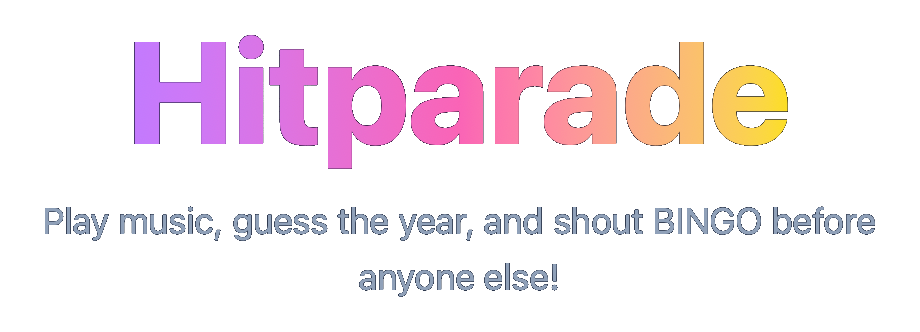

<p align="center">
  
</p>

A music bingo game where players listen to songs from a Spotify playlist, guess the year, and race to complete a row on their bingo card. The host picks a playlist and starts the game, players join with a code, and each round a song plays with a category to guess (decade, exact year, before/after 2000, etc.). Guess correctly to mark a square — get five in a row to win!

Built with SvelteKit, Svelte 5, Tailwind CSS, and Flowbite Svelte. <br> Built using Claude Code.

## Table of Contents

- [Spotify Setup](#spotify-setup)
- [Development](#development)
- [Production](#production)

## Spotify Setup

Hitparade uses the Spotify Web API to play songs from playlists. You need a Spotify Developer account to get API credentials.

1. Go to the [Spotify Developer Dashboard](https://developer.spotify.com/dashboard) and create a new app.
2. In the app settings, add a redirect URI:
   - For development: `http://127.0.0.1:5173/api/spotify/callback`
   - For production: `https://your-domain.com/api/spotify/callback`
3. Copy `.env.example` to `.env` and fill in your credentials:
   ```
   SPOTIFY_CLIENT_ID=your_client_id
   SPOTIFY_CLIENT_SECRET=your_client_secret
   SPOTIFY_REDIRECT_URI=https://your-domain.com/api/spotify/callback
   SPOTIFY_REDIRECT_URI_DEV=http://127.0.0.1:5173/api/spotify/callback
   ```

## Development

The project runs in Docker with hot reload:

```bash
docker compose --profile dev up --build
```

The dev server is available at [localhost:5173](http://localhost:5173).

To run commands inside the container:

```bash
docker compose --profile dev exec hitparade-dev <command>
```

## Production

Build and run the production container:

```bash
docker compose --profile prod up --build
```

The app is served at [localhost:3001](http://localhost:3001) (mapped to port 3000 inside the container).

Set the required environment variables in your `.env` file or pass them to Docker. Make sure `SPOTIFY_REDIRECT_URI` matches the redirect URI configured in your Spotify app and points to your production domain.

---

<p align="center">
  
</p>
